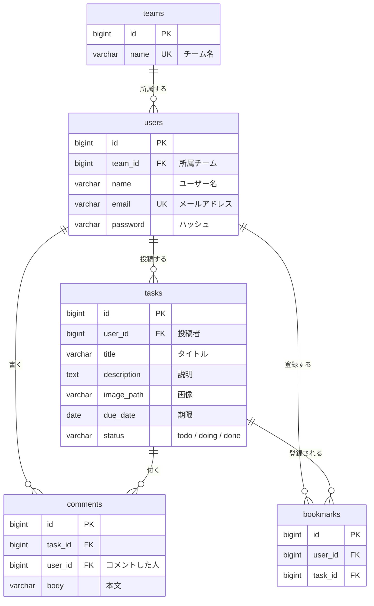

# ER図：チーム業務共有ボード

> テーブル同士の関係を表した図。各テーブルのカラムの詳細は [table-definitions.md](./table-definitions.md) を参照。

## テキスト形式

```
teams (1) ----< (N) users

users (1) ----< (N) tasks

users (1) ----< (N) comments
tasks (1) ----< (N) comments

users (N) >----< (N) tasks  [bookmarks: 中間テーブル]
```

| リレーション | 内容 |
|---|---|
| teams 1 : N users | 1つのチームに複数のメンバーが所属する（1人が所属するのは1チームだけ） |
| users 1 : N tasks | 1人のメンバーが複数の業務を投稿する |
| tasks 1 : N comments | 1つの業務に複数のコメントが付く |
| users 1 : N comments | 1人のメンバーが複数のコメントを書く |
| users N : N tasks（bookmarks） | 1人が複数の業務をブックマークでき、1つの業務は複数の人にブックマークされる |

> チームの業務一覧（F-05）は「tasks → users（投稿者）→ team_id」でたどって、自分と同じチームの業務を取り出す。

## 図（Mermaid）

GitHub 上では、次の図が自動で描画される。



## 記号の読み方

| 記号 | 意味 |
|---|---|
| `(1) ----< (N)` | 左の1件に対して、右が複数件（1対多） |
| `(N) >----< (N)` | お互いに複数件（多対多）。間に中間テーブルを置く |
| `\|\|--o{`（Mermaid） | 左はちょうど1件、右は0件以上 |
| PK / FK / UK | 主キー / 外部キー / 一意（重複不可） |

> users と tasks の多対多（ブックマーク）は、中間テーブル `bookmarks` で「users 1:N bookmarks」と「tasks 1:N bookmarks」の2つの1対多に分けて表している。
> 同じ組み合わせを二重に登録できないよう、`(user_id, task_id)` に UNIQUE 制約を付けている。
