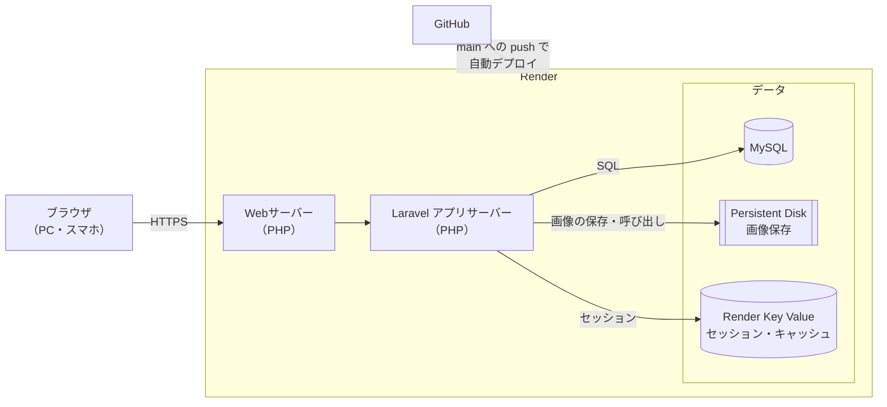

# インフラ構成：チーム業務共有ボード

> 公開環境のインフラ構成。元の図は [infrastructure.drawio](./infrastructure.drawio)（draw.io で開いて編集できる）。

## 構成図

> GitHub 上ではこの図が自動で描画される（Mermaid 記法）。正式な図は `infrastructure.drawio`。

## 構成要素

| 要素 | サービス | 役割 |
|---|---|---|
| ブラウザ | ― | メンバーが PC・スマホからアクセスする。通信はすべて HTTPS |
| Webサーバー | Render（Web Service） | リクエストを受け取り、Laravel に渡す。HTTPS の証明書は Render が自動で発行・更新する |
| アプリサーバー | Render（Web Service） | Laravel アプリ本体。画面の表示、業務の CRUD、権限チェック（Policy）、ブックマークの Ajax などを処理する |
| データベース | MySQL | ユーザー・チーム・業務・コメント・ブックマークを保存する（`02_database-design/table-definitions.md`） |
| 画像の保存先 | Persistent Disk | 業務に添付した画像を保存する（`storage/app/public`）。再デプロイしても消えない |
| セッション・キャッシュ | Render Key Value（Redis 互換） | ログイン状態（セッション）とキャッシュを保存する |
| ソースコード | GitHub | `main` ブランチに push すると、Render が自動でデプロイする |

## 処理の流れ

### 画面を開くとき
1. ブラウザから HTTPS でアクセスする
2. Webサーバーが受け取り、Laravel アプリサーバーに渡す
3. Laravel が Render Key Value のセッションを確認し、ログインしているか判定する（未ログインならログイン画面へ）
4. MySQL から業務などのデータを取得して画面を作り、ブラウザに返す

### 画像をアップロードするとき
1. 業務の投稿・編集画面から画像を送る
2. Laravel がバリデーション（jpg / png / webp、2MB まで）をする
3. Persistent Disk に保存し、保存先のパスを MySQL の `tasks.image_path` に記録する

### デプロイするとき
1. 機能ごとのブランチで開発し、PR を `main` にマージする
2. `main` への push をきっかけに、Render が自動でビルド・デプロイする
3. デプロイ時にマイグレーション（`php artisan migrate --force`）を実行する

## 要件定義書との対応

| 非機能要件 | この構成での対応 |
|---|---|
| 通信は HTTPS 化する | Render が HTTPS の証明書を自動で発行・更新する |
| ページの読み込み 5秒以内 | セッション・キャッシュを Render Key Value（メモリ上）に置き、DB の負荷を減らす |
| 稼働率 99% 以上 | Render のマネージドサービスを使い、サーバーの管理（OS 更新など）を任せる |
| 画像の保存先はローカル（S3 は発展） | Persistent Disk に保存する（Laravel から見るとローカルのディスク） |
| GitHub で変更履歴を残す | `main` への push で自動デプロイ。デプロイの履歴が GitHub と Render に残る |

## 構築前に確認すること

| 項目 | 内容 |
|---|---|
| MySQL の用意 | Render のマネージド DB は PostgreSQL のため、MySQL は Render 上に別サービス（Private Service＋ディスク）として立てるか、外部の MySQL サービスを使う。どちらにするか決める |
| Persistent Disk の制限 | ディスクを付けたサービスは、台数を増やせず、デプロイ中に短時間止まる。利用者30名程度なら問題ないが、利用者が増えたら S3 への移行（F-19）を検討する |
| 料金 | Persistent Disk と Key Value は有料プランが必要。月額を確認する |
